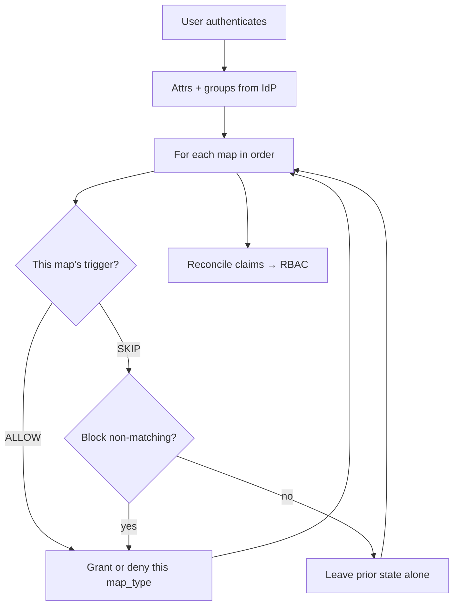

# AAP Authenticator Maps — Auth Method Mappings

> **Purpose:** Explain how Gateway **authenticator maps** (UI: Auth Method → Mappings) evaluate triggers, especially **“How to apply the rule”** (`at least one` / `all`), and how that differs from DAB RBAC role assignments.
>
> **Audience:** Humans and agents troubleshooting login-time org/team/role placement.
>
> **Last derived from:** AAP 2.6 local clones — `django-ansible-base` (`ansible_base.authentication.utils.claims`), `aap-ui` mapping forms, product docs `secure-assembly_gw_mapping`.
>
> **Related:** [AAP-RBAC-GUIDE.md](AAP-RBAC-GUIDE.md) · [AAP-RBAC-AGENT-CONTEXT.md](AAP-RBAC-AGENT-CONTEXT.md) · [AAP-RBAC-ORGANIZATIONAL-DESIGN.md](AAP-RBAC-ORGANIZATIONAL-DESIGN.md)

---

## Where this sits relative to RBAC

Authenticator maps are **not** the DAB permission matrix. They run **at login** (after the authenticator validates identity) and produce **claims** that are later reconciled into role assignments (org membership, team membership, system roles, superuser, allow/deny login).

```text
IdP / LDAP / SAML / OIDC
        │
        ▼
Authenticator (identity + attrs + groups)
        │
        ▼
Authenticator maps (ordered rules → in-memory claims)
        │
        ▼
ReconcileUser → RoleDefinition assignments (DAB RBAC)
```

If someone asks “why is this user in Org X / Team Y / System Auditor?”, check **maps first**, then existing role assignments.

---

## Core mental model

Think **firewall rules / mail filters**, not “one big AND across all mappings.”

1. After auth, Gateway starts with default in-memory permissions (e.g. access allowed = true; superuser undefined).
2. Maps for that authenticator load in **`order`**.
3. Each map evaluates **its own** trigger → `ALLOW`, `SKIP`, or (with revoke) `DENY`.
4. Matching maps mutate shared in-memory state for that map type (allow, superuser, org, team, role).
5. After all maps, claims reconcile to real orgs/teams/role assignments.



**Important:** “How to apply the rule” does **not** AND/OR **map A with map B**. Cross-map effects come only from **order** + **shared in-memory state** + **Block non-matching users**.

---

## Map types (`map_type`)

| Type | Effect when trigger matches |
|------|-----------------------------|
| `allow` | Allow or deny platform login |
| `is_superuser` | Set / clear superuser |
| `organization` | Org membership (+ role on that org) |
| `team` | Team membership (+ role on that team) |
| `role` | Role assignment (system, org, or team scoped depending on fields) |

UI labels: Allow, Organization, Team, Role, Superuser.

---

## Triggers — “When to apply the rule”

| UI value | Stored trigger | Meaning |
|----------|----------------|---------|
| Always | `{"always": {}}` | Always `ALLOW` |
| Never | `{"never": {}}` | Always `DENY` |
| Based on groups | `{"groups": {...}}` | Match IdP/LDAP groups |
| Based on attributes | `{"attributes": {...}}` | Match user attributes from the source |

---

## “How to apply the rule” — Condition type (intra-map only)

UI label: **How to apply the rule** (`at least one` / `all`).  
Product docs label: **Condition type**.

No `labelHelp` in the UI today — that mismatch is a common source of confusion.

### Groups

| UI | API JSON | Meaning |
|----|----------|---------|
| at least one | `groups.has_or: [g1, g2, …]` | User needs **any** listed group |
| all | `groups.has_and: [g1, g2, …]` | User needs **every** listed group |

With a **single** group, `all` vs `at least one` does not matter.

Code path: `process_groups()` in `ansible_base/authentication/utils/claims.py`.

### Attributes

| UI | API JSON | Meaning |
|----|----------|---------|
| at least one | `attributes.join_condition: "or"` | OR across attribute criteria (and across multi-values) |
| all | `attributes.join_condition: "and"` | AND across attribute criteria (and across multi-values) |

`join_condition` does **two** jobs inside **one** map:

1. **Multiple attribute keys** on the same map (e.g. `email` and `department`)
2. **Multiple values** when the IdP returns a list for one attribute (e.g. two emails)

Example — multi-value surprise with `all`:

```json
{
  "attributes": {
    "join_condition": "and",
    "email": { "equals": "alice@example.com" }
  }
}
```

| User `email` from IdP | Result |
|-----------------------|--------|
| `"alice@example.com"` | ALLOW |
| `["alice@example.com", "alice@corp.com"]` | **SKIP** — not every list value equals the target |

With `at least one` / `"or"`, any matching value is enough.

Code path: `process_user_attributes()` → `has_access_with_join()` in `claims.py`.  
(Note: `has_access_with_join`’s docstring says “join of authenticator_maps”; that docstring is misleading — call sites only join **within** one attribute trigger.)

### UI → API serialization

```text
groups + "at least one"  →  triggers.groups.has_or
groups + "all"           →  triggers.groups.has_and
attributes + either      →  triggers.attributes.join_condition = "or" | "and"
```

---

## Block non-matching users (`revoke`)

| Trigger result | `revoke` false | `revoke` true |
|----------------|----------------|---------------|
| ALLOW | Grant the map’s permission | Grant |
| SKIP | **No change** to in-memory state for that map | Treat as **DENY** (revoke that permission) |

This is how you encode “must be in this group or lose X” (legacy LDAP `AUTH_LDAP_REQUIRE_GROUP`-style allow maps, or “only these users stay superuser”).

Without revoke, a non-matching map is a no-op — later or earlier maps keep their effect for that field unless another map overwrites it.

---

## How multiple maps compose (the part that feels like “across mappings”)

Maps are independent triggers. Shared state makes them **interact**:

| Scenario | What happens |
|----------|--------------|
| Two Allow maps | Later matching Allow overwrites `access_allowed` |
| Superuser map SKIP, no revoke | Superuser stays whatever prior maps left (often unset) |
| Superuser map SKIP + revoke | Superuser forced false |
| Team/Org maps for different targets | Independent keys in the claims dict |
| Same org/team/role touched twice | Later map’s grant/deny wins for that key |

**Order matters.** Treat the Mapping order screen like firewall rule priority.

---

## Worked examples

### Require LDAP group to log in

1. Map type **Allow**, trigger **Never** (optional first deny-all pattern), **or** start open and tighten.
2. Map type **Allow**, groups `has_or: ["cn=aap-users,…"]`, **Block non-matching users** checked.

Equivalent intent to classic `AUTH_LDAP_REQUIRE_GROUP`.

### Put users in a team from one AD group

1. Map type **Team**, role Team Member, org + team names set.
2. Trigger **Based on groups**, one group, condition either value.
3. Leave revoke off if you only want to **add** members when they match (non-match leaves existing membership alone unless another map / remove-users policy clears it).

### Groups delivered as a multi-value `groups` **attribute** (common IdP / OIDC case)

Some customers do **not** (or not only) use the authenticator’s dedicated groups channel. Instead the IdP puts membership in a user attribute named `groups` (a list), for example:

```json
{
  "email": "alice@example.com",
  "groups": ["aap-org-a", "aap-team-ops", "aap-team-sre"]
}
```

`create_claims` evaluates two **different** inputs:

| Trigger UI | Code input | Use when |
|------------|------------|----------|
| **Based on groups** | `groups: list[str]` passed beside attrs (LDAP membership, OIDC `GROUPS CLAIM` / `groups_claim` extraction, etc.) | Membership was extracted into the authenticator’s groups list |
| **Based on attributes** | Keys inside `attrs` / `extra_data` (including a key literally named `groups`) | Membership only appears as an attribute list |

If the customer maps against the attribute list, they must use **Based on attributes**, attribute name `groups` — **not** “Based on groups.” Those are not interchangeable unless the authenticator also copies that claim into the groups channel.

#### One team map per group value (typical pattern)

They create **separate** Team / Organization maps, each looking for one string in that list:

**Map A — Team Ops**

| Field | Value |
|-------|--------|
| Authentication mapping | Team |
| When to apply the rule | Based on attributes |
| How to apply the rule | **at least one** |
| Attribute | `groups` |
| Comparison | `equals` (or `contains` if you need substring match) |
| Value | `aap-team-ops` |

API shape:

```json
{
  "name": "team-ops-from-groups-attr",
  "map_type": "team",
  "organization": "Org A",
  "team": "Ops",
  "role": "Team Member",
  "revoke": false,
  "triggers": {
    "attributes": {
      "join_condition": "or",
      "groups": { "equals": "aap-team-ops" }
    }
  }
}
```

**Map B — Team SRE** (same pattern, value `aap-team-sre`, different team target).

With Alice’s attrs above:

| Map | `join_condition` | Result | Why |
|-----|------------------|--------|-----|
| Team Ops | **at least one** (`or`) | ALLOW → add to Ops | Any list element may equal `aap-team-ops` |
| Team SRE | **at least one** (`or`) | ALLOW → add to SRE | Same for `aap-team-sre` |
| Team Ops | **all** (`and`) | **SKIP** | `and` requires **every** value in `groups` to equal `aap-team-ops`; Alice also has `aap-org-a` and `aap-team-sre` |
| Team SRE | **all** (`and`) | **SKIP** | Same failure mode |

So for “is group X in this attribute list?”, **always use at least one**. Using **all** only makes sense if you truly need every returned value to match the comparison (almost never true for a multi-group membership list).

This is the same rule as the email list example earlier: multi-value attribute + `and` means all values must match, not “user must have this one membership.”

#### Same intent with **Based on groups** (when the groups channel is populated)

If the authenticator already exposes `["aap-org-a", "aap-team-ops", "aap-team-sre"]` on the groups channel (e.g. OIDC Groups claim configured), prefer:

| Field | Value |
|-------|--------|
| When to apply the rule | Based on groups |
| How to apply the rule | **at least one** (same as `has_or`) |
| Groups | `aap-team-ops` |

```json
{
  "triggers": {
    "groups": { "has_or": ["aap-team-ops"] }
  }
}
```

Here “How to apply the rule” joins **multiple Groups field entries on that one map** (`has_or` vs `has_and`), not values inside an attribute. With a single group entry, `all` vs `at least one` does not matter. With two entries on one map (`aap-team-ops` and `aap-team-sre`):

- **at least one** → user needs either group  
- **all** → user needs both groups  

Multiple **separate** maps (one group each) still do not get joined by that dropdown; each map runs on its own in order.

#### Practical guidance for this customer pattern

1. Confirm where membership lives: attrs key `groups` vs authenticator groups list (logs: `{username}'s groups:` vs `{username}'s attrs:`).
2. Attribute-list path → **Based on attributes**, `groups` + `equals`/`contains`, **How to apply = at least one**.
3. One map per org/team target is fine; do not set **all** expecting “match this one group among many.”
4. Prefer configuring the authenticator’s groups claim so **Based on groups** works — clearer UX and no multi-value `join_condition` footgun.
5. Optional: comparison `in` with a list of acceptable names is another attribute-style option; `join_condition` still governs how multi-value user data is combined (see unit tests in `test_claims.py`).

### Multi-attribute map via API

```json
{
  "map_type": "role",
  "role": "Platform Auditor",
  "triggers": {
    "attributes": {
      "join_condition": "and",
      "department": { "equals": "platform" },
      "title": { "contains": "sre" }
    }
  },
  "revoke": true
}
```

User needs **both** attributes to match. If the IdP returns multi-value lists, **every** value of each listed attribute must satisfy its comparison when `join_condition` is `"and"`.

**UI caveat (product docs):** multi-attribute triggers can be stripped if the authenticator/mapping is re-saved through the UI; prefer API for multi-attribute experiments.

---

## Common misunderstandings

| Belief | Reality |
|--------|---------|
| “How to apply the rule” ANDs/ORs **this map with other maps** | False — it only joins groups/attrs **inside this map** |
| Maps are independent and never affect each other | False — they share ordered in-memory state; revoke and order compose effects |
| `all` on a single-attribute map is always harmless | False if the IdP returns a **list** of values |
| IdP attribute `groups: [...]` is the same as **Based on groups** | False unless the authenticator also fills the groups channel; attribute lists need **Based on attributes** |
| Multiple team maps + `groups` list → use **all** so “they have that group” | False — use **at least one**; **all** requires every list value to match |
| Authenticator maps = RBAC role editor | False — maps feed claims that become role assignments at login |
| Docs “Condition type” is a different setting | Same control as UI “How to apply the rule” |

---

## Debugging checklist

1. Confirm which **authenticator** the user hit (local vs LDAP vs SAML/OIDC).
2. Dump the user’s **attrs** and **groups** as the authenticator returns them (casefolding is applied for groups/attrs in claims code).
3. List maps for that authenticator ordered by **`order`**.
4. For each map, evaluate trigger alone → ALLOW / SKIP / DENY (with revoke).
5. Walk the in-memory allow / superuser / org / team / role state after each map.
6. Check reconciler outcome: role assignments vs `remove_users` / create_objects on the authenticator.
7. Gateway logs: look for `Creating mapping for user` / `Map [<id>]` debug lines from `ansible_base.authentication.utils.claims` (tracking UUID per login).

API surfaces (Gateway):

```http
GET /api/gateway/v1/authenticators/
GET /api/gateway/v1/authenticator_maps/?authenticator=<id>
```

---

## Source map (AAP 2.6 lab paths)

| Concern | Location |
|---------|----------|
| Claim evaluation | `aap-26/common/django-ansible-base/ansible_base/authentication/utils/claims.py` |
| Trigger schema | `…/authentication/utils/trigger_definition.py` |
| Model | `…/authentication/models/authenticator_map.py` |
| Unit tests (groups / join / multi-value) | `…/test_app/tests/authentication/utils/test_claims.py` |
| UI labels + serialization | `aap-26/ui/aap-ui/platform/access/authenticators/components/MappingFields.tsx`, `AuthenticatorMappingForm.tsx` |
| Product narrative | `aap-26/product-docs/secure/secure-assembly_gw_mapping.md` |

---

## Verdict for support cases

- **Not a product bug** if “all / at least one” appears to affect outcomes involving multiple mapping rows — that is almost always **order + revoke + shared claims state**, or **multi-valued attributes** under `join_condition: and`.
- **UX/docs gap** (reasonable RFE): rename/help-text “How to apply the rule” → “Condition type (within this mapping)” and document the dual use for attribute lists vs multiple attributes.
- File a functional bug only with a repro where one map’s `join_condition` changes **another map’s trigger evaluation** (that path does not exist in `create_claims`).
